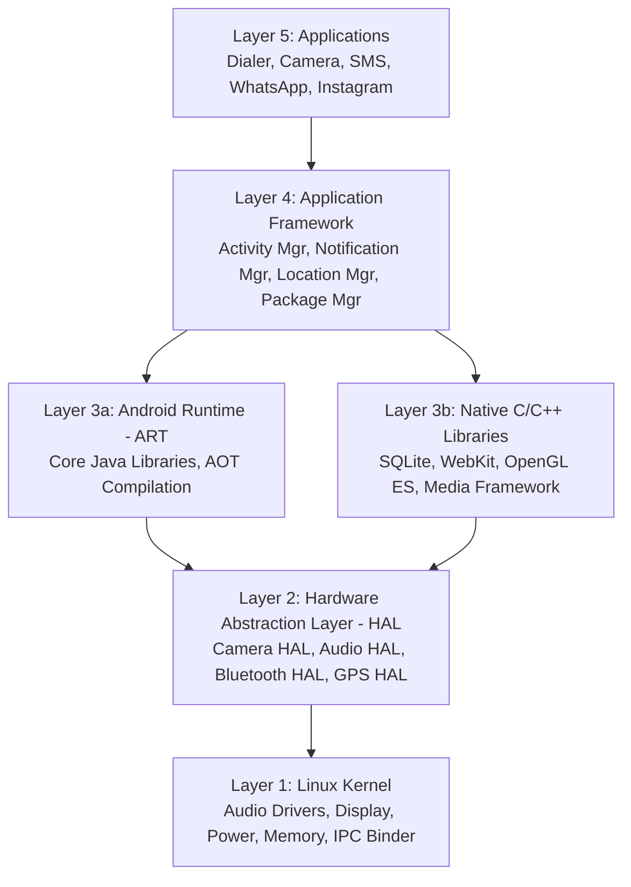

	# Unit I: Introduction to Android & Android Architecture
**Subject:** Android Programming (`BCAFSCO501T23`)  
**Target:** BCA Semester V Mid-Term & University Examination  
**Official Reference:** Professor's Teaching Slides (`UNIT I.pdf`, 17 Pages)  

---

## 1. Unconditional Truths (The Axioms)

1. **Kernel Abstraction:** Android is not standard desktop Linux, but a mobile operating system built directly on top of the **Linux Kernel**, utilizing it for low-level memory management, process isolation, power management, and hardware device drivers.
2. **Layered Decoupling (The 5 Layers):** Software execution follows a strict 5-tier vertical hierarchy: **Applications $\rightarrow$ Application Framework $\rightarrow$ Android Runtime (ART) & Native C/C++ Libraries $\rightarrow$ Hardware Abstraction Layer (HAL) $\rightarrow$ Linux Kernel**.
3. **Application Sandboxing:** Every Android application executes inside its own isolated Linux process with a dedicated, unique User ID (UID), ensuring that no application can access another application's memory or private data without explicit system permissions.
4. **Hardware Neutrality via HAL:** High-level Java/Kotlin applications never interact directly with raw hardware or device registers. They communicate through standard C/C++ interface contracts provided by the **Hardware Abstraction Layer (HAL)**.

---

## 2. Motivated Discovery ("Why Does This Exist?")

### The Pre-Android Era (Around 2003):
Before Android, mobile phones were dominated by fragmented, closed proprietary platforms:
* **Operating Systems:** Nokia (Symbian), BlackBerry OS, Windows Mobile, Palm OS.
* **Limitations:**
  * Highly limited third-party application support.
  * No centralized application marketplace (No Google Play Store).
  * No advanced multi-touch gesture interfaces.
  * No built-in AI or voice assistants.
  * Very primitive, carrier-locked internet handling.

### The Inception & Breakthrough:
* **Inception (2003):** Founded by **Andy Rubin, Rich Miner, Nick Sears, and Chris White** under *Android Inc.* with the initial goal of creating an advanced operating system for digital cameras, before pivoting to smart touchscreen mobile devices.
* **Google Acquisition (August 2005):** Google acquired Android Inc. Key founders joined Google to lead mobile OS development.
* **Open Handset Alliance (OHA) (November 2007):** Google formed the OHA—a consortium of 84+ hardware and telecom leaders (Google, HTC, Sony, Dell, Intel, Motorola, Qualcomm, Texas Instruments)—to establish an **open, royalty-free standard** for mobile computing.
* **The First Commercial Android Phone (September 2008):** The **HTC Dream** (launched in the US as the **T-Mobile G1**) debuted running Android 1.0, featuring a touchscreen, slide-out physical keyboard, Gmail, Google Maps, web browser, and the **Android Market** (now Google Play Store).

---

## 3. Dependency Map (The 5-Layer Android Architecture)

---

## 4. Deep-Dive: Core Concepts from Professor's Notes

---

### 4.1 Definitions of Android
* **Simple Definition:** Android is an Operating System (OS) developed mainly by Google for smartphones, tablets, TVs, smartwatches, smart cars, and connected devices. It manages both device hardware and software.
* **Technical Definition:** Android is an open-source, Linux-based mobile operating system that provides a robust application framework, an execution runtime, and middleware allowing developers to build rich applications using Java and Kotlin.

---

### 4.2 Complete Android Version Evolution Table

From Android 1.5 up to Android 9 (Pie), releases were named alphabetically after desserts. From Android 10 onwards, Google adopted numerical versioning for public clarity.

| Version | Name / Code | Major University-Tested Feature |
| :---: | :--- | :--- |
| **1.5** | **Cupcake** | First on-screen Virtual Keyboard; video recording. |
| **1.6** | **Donut** | Quick Search Box; support for diverse screen resolutions. |
| **2.0 / 2.1** | **Eclair** | Google Maps Turn-by-Turn Navigation; live wallpapers. |
| **2.2** | **Froyo** (Frozen Yogurt) | JIT compiler introduced for faster performance; Wi-Fi hotspot. |
| **2.3** | **Gingerbread** | Optimized for mobile gaming; NFC support; download manager. |
| **3.0** | **Honeycomb** | Tablet-only OS; holographic UI; Action Bar introduction. |
| **4.0** | **Ice Cream Sandwich** | Unified phone & tablet UI; Holo theme; Face Unlock. |
| **4.1–4.3** | **Jelly Bean** | "Project Butter" for smooth 60fps UI; Google Now; expandable notifications. |
| **4.4** | **KitKat** | Memory optimization for low-RAM (512MB) devices; "OK Google". |
| **5.0** | **Lollipop** | **Material Design** UI; introduced ART runtime replacing Dalvik. |
| **6.0** | **Marshmallow** | **Runtime Permissions** model; Doze mode for battery saving. |
| **7.0** | **Nougat** | Native Split-Screen multi-window; Vulkan 3D graphics API. |
| **8.0** | **Oreo** | Picture-in-Picture (PiP) mode; Notification Dots; Autofill framework. |
| **9.0** | **Pie** | Gesture-based navigation; Adaptive Battery; Digital Wellbeing. |
| **10** | **Android 10** | System-wide Dark Mode; Gestural navigation; Project Mainline. |
| **11** | **Android 11** | One-time permissions; Chat Bubbles; screen recorder. |
| **12** | **Android 12** | "Material You" dynamic color theming; Privacy Dashboard. |
| **13** | **Android 13** | Per-app language settings; enhanced notification controls. |
| **14** | **Android 14** | Advanced lock screen customization; security improvements. |
| **15** | **Android 15** | Enhanced privacy sandbox; optimized foreground performance. |

---

### 4.3 Android OS Responsibilities & Analogies

#### The School Analogy (From Professor's Slide 8):
> Imagine a school:
> * **Teacher $\rightarrow$ Applications** (Perform specific tasks for students)
> * **Principal $\rightarrow$ Android OS** (Coordinates all operations, allocates classrooms, enforces rules)
> * **Students $\rightarrow$ Hardware** (CPU, RAM, Camera, Display)
> 
> *Without the principal, teachers and students work independently without coordination, leading to chaos. The Android OS coordinates every physical hardware component smoothly.*

#### The WhatsApp Lifecycle Flow (From Professor's Slide 8):
When a user taps to open WhatsApp:
1. Android checks available **RAM**.
2. **Allocates Memory** space for the WhatsApp process.
3. Schedules the **CPU** to execute the app logic.
4. Connects to the **Internet** via Wi-Fi or cellular network stack.
5. Displays the **User Interface (UI)** on the screen.
6. Reads and writes the local chat database in **SQLite Storage**.

#### Core Responsibilities of Android OS:
1. **Memory Management:** Allocates and frees RAM pages using an automated Garbage Collector.
2. **File Management:** Organizes internal flash storage and external SD cards.
3. **Process Management:** Allocates processes and isolates them with distinct Linux UIDs.
4. **Device Security:** Enforces permission sandboxes and cryptographic storage encryption.
5. **Network Management:** Coordinates Wi-Fi, 4G/5G cellular radio, and Bluetooth.
6. **User Interface:** Renders views, handles touch gestures, and manages screen orientation.
7. **Hardware Control:** Directly interfaces with camera, microphone, GPS, and sensors.
8. **Power Management:** Extends battery longevity via wake-locks and Doze mode.
9. **Permission Management:** Mediates user consent for sensitive hardware access.

#### 14 Key Features of Android OS (From Professor's Slide 9):
1. **Open Source:** AOSP source code is free and modifiable by device makers.
2. **Multi-tasking:** Runs multiple background processes concurrently.
3. **Multi-touch Support:** Handles multi-finger gestures (pinch-to-zoom).
4. **Bluetooth:** Wirelessly connects peripherals and audio devices.
5. **Wi-Fi:** High-speed local network connectivity.
6. **GPS:** Precise geographical positioning.
7. **Camera API:** Programmatic control over lenses, flash, focus, and sensors.
8. **Push Notifications:** Delivers remote cloud messaging via FCM.
9. **Google Play Store:** Official ecosystem of millions of apps.
10. **Voice Assistant:** Natural language voice commands (Google Assistant).
11. **Widgets:** Interactive home screen mini-applications.
12. **NFC (Near Field Communication):** Contactless payments and data exchange.
13. **Cloud Synchronization:** Backs up contacts, photos, and settings automatically.
14. **Security Permissions:** Granular runtime security guards for private user data.

#### Simultaneous Hardware Utilization (Google Maps Example):
When running Google Maps, Android coordinates:
$$\text{GPS} + \text{Internet (Cellular/Wi-Fi)} + \text{Storage (Cache)} + \text{Display (GPU)} + \text{CPU} \quad \text{— all simultaneously!}$$

---

### 4.4 Android Development Tools

#### 1. Android Studio:
* The official IDE recommended by Google (built on JetBrains IntelliJ IDEA).
* **The Engineering Workshop Analogy:** Like an all-in-one mechanical workshop where you don't buy drills, wrenches, and tables separately; everything (Code Editor, Emulator, Debugger, Layout Designer, Profiler, APK Builder) is pre-integrated.

#### 2. Java vs. Kotlin:
* **Java:** The traditional language used for Android apps (`System.out.println("Hello Android");`).
* **Kotlin:** Google's preferred modern language since 2019 (`println("Hello Android")`). Concise, prevents NullPointerExceptions, and interoperates 100% with Java.

#### 3. Android SDK:
* **The Kitchen Analogy:** Like a kitchen containing stove, pan, spoon, knife, and raw ingredients. The SDK contains everything needed to build an app:
  * Libraries & APIs (`android.jar`)
  * Build Tools (`aapt`, `dx`/`d8`, `zipalign`)
  * Platform Tools (`adb`, `fastboot`)
  * System Images & Documentation

#### 4. Android Emulator:
* A virtual mobile device running on the computer to test apps across different screen sizes and API levels without physical hardware.

#### 5. ADB (Android Debug Bridge):
* Command-line utility facilitating communication between development PC and device:
  * *Install APK:* `adb install app.apk`
  * *Debug application:* View stack traces via `adb logcat`
  * *Copy files:* `adb push <local> <remote>` / `adb pull <remote> <local>`
  * *View attached devices:* `adb devices`

---

### 4.5 The 5-Layer Android Architecture in Detail

#### The Shopping Mall Analogy (From Professor's Slide 14):
> Think of a multi-story shopping mall:
> * **Ground Floor $\rightarrow$ Security & Infrastructure (Linux Kernel)**
> * **First Floor $\rightarrow$ Building Services & Utilities (HAL)**
> * **Second Floor $\rightarrow$ Mall Management & Operations (Runtime & App Framework)**
> * **Third Floor $\rightarrow$ Retail Shops (Applications)**
> 
> *Customers only see and shop on the top floor, but every floor below works together to keep the mall running smoothly. Android apps rely on all four lower layers to function.*

#### Detailed Layer Breakdown:

1. **Layer 1 – Linux Kernel (The Root Foundation):**
   * Sits directly on hardware.
   * Functions: Memory allocation, process scheduling, power management, network stack, security isolation, and physical hardware drivers (Audio, Camera, Display, Keypad, Wi-Fi).
   * *Example:* Plugging in headphones triggers the Linux Kernel audio driver to redirect sound output.

2. **Layer 2 – Hardware Abstraction Layer (HAL):**
   * Acts as a vendor-neutral bridge between higher-level Java/Kotlin APIs and proprietary Linux kernel drivers.
   * Provides standard C/C++ module interfaces for: Camera, Bluetooth, GPS, Wi-Fi, Audio, and Fingerprint scanner.
   * *Example:* The camera app asks HAL for a preview frame; HAL speaks to the physical vendor-specific sensor.

3. **Layer 3 – Android Runtime (ART) & Native C/C++ Libraries:**
   * **Android Runtime (ART):** Executes `.dex` bytecode using Ahead-Of-Time (AOT) and JIT compilation, manages object garbage collection.
   * **Native C/C++ Libraries:** Precompiled system libraries providing raw processing power:
     * *SQLite:* Embedded relational database.
     * *OpenGL ES:* 2D and 3D graphics rendering engine.
     * *SSL / TLS:* Internet security and encryption.
     * *Media Libraries:* Audio/video decoders for MPEG-4, H.264, MP3, AAC.
     * *WebKit / Blink:* Web rendering engine.

4. **Layer 4 – Application Framework:**
   * High-level Java architectural toolkit that exposes phone capabilities to developers:
     * *Activity Manager:* Manages app lifecycles and the navigation back-stack.
     * *Notification Manager:* Emits status bar alerts, heads-up banners, and badges.
     * *Location Manager:* Manages GPS coordinates and geofences.
     * *Resource Manager:* Provides access to non-code XML strings, colors, and layouts.
     * *Window Manager:* Renders and organizes UI windows on screen.
     * *Package Manager:* Manages installed apps and queries metadata.
     * *Example:* When a food delivery app updates order status, the `NotificationManager` generates the notification.

5. **Layer 5 – Applications:**
   * The visible layer containing both pre-installed system apps (Phone, Camera, Settings, Chrome) and third-party apps (WhatsApp, Instagram, Banking apps).

---

### 4.6 End-to-End Real-Life Flow: Taking a Selfie (Slide 17)
1. User taps the **Camera App** icon (**Layer 5: Applications**).
2. The Camera app requests capture services from the `CameraManager` (**Layer 4: Application Framework**).
3. **ART** executes the app logic while **Media & Graphics Native Libraries** process the raw sensor pixels (**Layer 3: ART & Native Libs**).
4. The **Camera HAL** translates software capture commands into hardware-specific driver instructions (**Layer 2: HAL**).
5. The **Linux Kernel** powers the physical camera sensor, captures the photo, and writes the bytes to flash storage via the file driver (**Layer 1: Linux Kernel**).
6. The resulting photo is saved and displayed on screen!

---

## 5. Key Takeaways & Exam Scoring Pitfalls

* ⚠️ **Pitfall 1: Omitting the HAL Layer.** Many older internet diagrams show only 4 layers. **Your professor's slides explicitly test a 5-layer architecture with HAL between the Kernel and ART/Native Libraries.** Always draw all 5 layers!
* ⚠️ **Pitfall 2: Forgetting the Analogies.** Writing the **"School Analogy"** for the OS and the **"Shopping Mall Analogy"** for the architecture will immediately catch the examiner's eye and secure maximum marks.
* ⚠️ **Pitfall 3: Version Table Order.** Remember the dessert names are strictly alphabetical: C $\rightarrow$ D $\rightarrow$ E $\rightarrow$ F $\rightarrow$ G $\rightarrow$ H $\rightarrow$ I $\rightarrow$ J $\rightarrow$ K $\rightarrow$ L $\rightarrow$ M $\rightarrow$ N $\rightarrow$ O $\rightarrow$ P!

---

## 6. Comprehensive Mid-Term Question Bank for Unit I

### Section A: Short Answer Questions (2 Marks Each)

**Q1: What is Android? Give both a simple and technical definition.**  
*Answer:*  
* *Simple Definition:* Android is an operating system developed by Google that manages hardware and software for smartphones, tablets, TVs, and smart devices.
* *Technical Definition:* Android is an open-source, Linux-based mobile operating system providing an application framework, runtime execution engine, and managed middleware allowing developers to build apps using Java and Kotlin.

**Q2: Who founded Android Inc. and in which year? When did Google acquire it?**  
*Answer:* Android Inc. was founded in **2003** by **Andy Rubin, Rich Miner, Nick Sears, and Chris White**. Google acquired Android Inc. in **August 2005**.

**Q3: What was the first commercially released Android smartphone? Name the device and launch year.**  
*Answer:* The first commercial Android phone was the **HTC Dream** (released in the USA as the **T-Mobile G1**) in **September 2008**, running Android 1.0.

**Q4: What is the Open Handset Alliance (OHA)?**  
*Answer:* Formed in November 2007 by Google, the OHA is a consortium of 84+ mobile and technology companies (including Google, HTC, Sony, Intel, Qualcomm) dedicated to establishing open, royalty-free standards for mobile devices.

**Q5: Why were early Android versions named after desserts? When did Google stop using dessert names publicly?**  
*Answer:* Early releases were named alphabetically after confectioneries/desserts (Cupcake, Donut, Eclair, Froyo... up to Pie) to signify sweetness and developmental fun. Starting with **Android 10**, Google discontinued public dessert names for global numerical simplicity.

**Q6: What is the Hardware Abstraction Layer (HAL) in Android?**  
*Answer:* HAL is a middle layer providing standard C/C++ interface hooks that expose device hardware capabilities (Camera, Bluetooth, GPS, Audio) to the higher-level Java framework without exposing proprietary kernel driver code.

**Q7: Name four native C/C++ libraries included in the Android software stack.**  
*Answer:*
1. **SQLite:** Embedded transactional relational database.
2. **OpenGL ES:** 2D and 3D graphics rendering engine.
3. **WebKit / Blink:** Web browser layout engine.
4. **Media Framework:** Audio and video playback/recording codecs.

**Q8: What is ADB? Write the command to install an APK file.**  
*Answer:* Android Debug Bridge (ADB) is a command-line tool connecting a development PC to an emulator or physical device. Command to install: `adb install app.apk`.

**Q9: Explain the School Analogy used to describe the Android Operating System.**  
*Answer:* In a school, teachers represent Apps, students represent physical Hardware, and the Principal represents the Android OS. Without the principal, everyone acts independently without coordination; Android coordinates all hardware components seamlessly.

**Q10: List four key responsibilities of the Android Operating System.**  
*Answer:*
1. Memory Management (RAM allocation and cleanup).
2. Process Management (isolating apps into secure UID sandboxes).
3. Power Management (Doze mode, wake-locks).
4. Device Security & Permission Management.

---

### Section B: Medium Answer Questions (5 Marks Each)

**Q11: Explain the evolution of Android versions from Android 1.5 to Android 15, mentioning at least 8 versions with their major features.**  
*Answer:* *(Provide the Version Table from Section 4.2 highlighting Cupcake [Virtual Keyboard], Donut [Search], Eclair [Maps], Froyo [JIT/Speed], Gingerbread [Gaming/NFC], KitKat [Low-RAM], Lollipop [Material Design/ART], Marshmallow [Runtime Permissions], Pie [Gestures], and Android 10 [Dark Mode]).*

**Q12: Differentiate between Java and Kotlin in Android application development. Why does Google recommend Kotlin?**  
*Answer:*
| Comparison Parameter | Java | Kotlin |
| :--- | :--- | :--- |
| **Introduction** | Traditional language since Android 1.0. | Google's preferred language since 2019. |
| **Syntax Verbosity** | Verbose (requires extensive boilerplate). | Concise (reduces boilerplate code by 40%). |
| **Null Safety** | Prone to `NullPointerException` crashes. | Built-in null-safety operators (`?`, `!!`). |
| **Hello World Syntax**| `System.out.println("Hello Android");` | `println("Hello Android")` |
| **Interoperability** | 100% interoperable with Kotlin. | 100% interoperable with Java. |
*Google recommends Kotlin because it eliminates common developer errors like null pointer exceptions, writes cleaner concise code, and is backed by official Jetpack libraries.*

**Q13: Explain the Android SDK using the "Kitchen Analogy". What core components does the SDK contain?**  
*Answer:*
* *The Analogy:* If cooking a meal, the SDK is like a fully equipped kitchen with a stove, pan, spoon, knife, and ingredients ready for use.
* *Components:*
  1. **Platform APIs (`android.jar`):** Houses Java class definitions for activities, views, and system services.
  2. **SDK Build Tools:** Includes `aapt` (packaging resources) and `dx`/`d8` (compiling bytecode into `classes.dex`).
  3. **SDK Platform Tools:** Includes runtime utilities like `adb` (Android Debug Bridge).
  4. **System Images:** Virtual machine OS images used to run emulators.
  5. **Documentation & Sample Code:** Guides and API references.

**Q14: Describe the step-by-step lifecycle flow of what happens inside Android OS when a user opens an application like WhatsApp.**  
*Answer:*
When WhatsApp is tapped:
1. **Checks RAM:** OS inspects available physical memory.
2. **Allocates Memory:** Creates a dedicated virtual memory page for the WhatsApp process.
3. **Uses CPU:** Schedules processor threads to run the app's initial bytecode.
4. **Connects to Internet:** Establishes TCP/IP sockets over Wi-Fi or cellular radio stack.
5. **Shows User Interface:** Inflates layout views and renders them on the physical display.
6. **Stores Chat Database:** Queries and updates local SQLite database files on disk.

**Q15: Explain how Android coordinates multiple hardware components simultaneously using the Google Maps example.**  
*Answer:*
When a user navigates using Google Maps, the Android OS orchestrates 5 hardware subsystems concurrently:
1. **GPS:** Receives real-time satellite coordinates.
2. **Internet (Cellular/Wi-Fi):** Downloads live traffic updates and map vector tiles.
3. **Storage:** Caches offline maps and user preferences in local flash memory.
4. **Display & GPU:** Renders 60fps vector maps, 3D buildings, and route poly-lines.
5. **CPU:** Computes real-time shortest-path route recalculations and ETA.

---

### Section C: Long Answer Questions (10/12 Marks Each)

**Q16: Draw the complete 5-layer Android Architecture diagram and explain each layer in detail with real-world examples.**  
*Answer:*  
1. *Draw the complete 5-layer ASCII/block diagram from Section 4.5.*  
2. *Explain the Shopping Mall analogy.*  
3. *Provide the in-depth description of each layer:*
   * **Linux Kernel:** Foundation layer; hardware drivers (Audio, Camera, Wi-Fi), memory, process isolation, power. Example: Headphone audio driver routing.
   * **HAL (Hardware Abstraction Layer):** Standard C/C++ interface for Camera, Bluetooth, GPS, Sensors.
   * **ART & Native Libraries:** ART executes DEX bytecode; Native libraries include SQLite (DB), WebKit (web), OpenGL ES (graphics), and Media codecs.
   * **Application Framework:** Java services including `ActivityManager`, `NotificationManager`, `LocationManager`, `ResourceManager`. Example: Food delivery order alert.
   * **Applications:** Top layer; Phone, Camera, Settings, WhatsApp, Instagram.

**Q17: Describe the end-to-end real-life flow of what occurs across all 5 layers of the Android architecture when a user takes a selfie.**  
*Answer:*  
*Step 1 (Applications Layer):* User taps the Camera app icon on screen.  
*Step 2 (Application Framework):* App requests camera capture service via `CameraManager`.  
*Step 3 (Android Runtime & Native Libraries):* ART executes Java app logic; native Media & Graphics libraries allocate and process frame buffers.  
*Step 4 (Hardware Abstraction Layer - HAL):* The Camera HAL converts software capture requests into hardware-specific driver commands.  
*Step 5 (Linux Kernel):* The Linux Kernel triggers the physical CMOS camera sensor, powers the flash, and writes the image file to storage via file drivers.  
*Step 6:* The resulting JPEG file is saved and displayed back on the screen!
