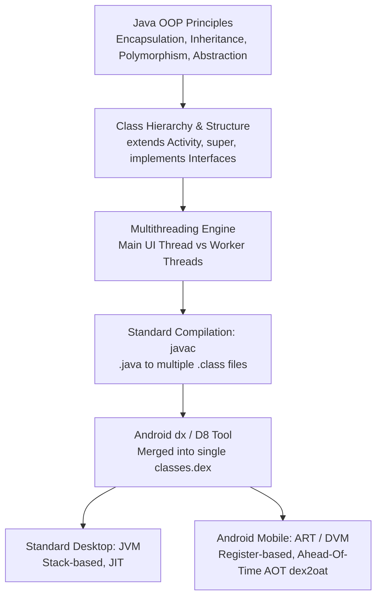

# Unit II: OOP Foundations in Java & Android Runtime (JVM, DVM & ART)
**Subject:** Android Programming (`BCAFSCO501T23`)  
**Target:** BCA Semester V Mid-Term & University Examination  
**Official Reference:** Professor's Teaching Notes (`BCA-V-Unit-II-III Android Notes.pdf`, Pages 1–9)  

---

## 1. Unconditional Truths (The Axioms)

1. **Object-Oriented Mandate:** Android application development is rooted entirely in Java object-oriented principles: every visual screen is a class extending `Activity`, every lifecycle event is an overridden method, and every button tap is an interface callback.
2. **Inheritance Singularity:** Java does **not** allow multiple inheritance with classes (to eliminate the Diamond Problem). In Android, multiple inheritance of type is achieved exclusively through **Interfaces**.
3. **Dynamic Method Dispatch:** When a superclass reference points to a subclass object, the JVM/ART determines which method to call at **runtime based on the actual object created in memory**, not the variable's compile-time type.
4. **The UI Thread Single-Thread Rule:** Android user interfaces run strictly on a single thread (the Main UI Thread). Blocking this thread for **5 seconds or longer** triggers a fatal **Application Not Responding (ANR)** crash dialog.
5. **Architectural Virtual Machine Divergence:** Standard Java executes on a **Stack-based JVM** reading separate `.class` files. Android applications execute on a **Register-based Virtual Machine (Dalvik / ART)** reading a single, unified, compressed Dalvik Executable (`classes.dex`).

---

## 2. Motivated Discovery ("Why Does This Exist?")

### Why does Android rely heavily on OOP and a custom Virtual Machine?
* **Polymorphism for Event Handling:** Android does not know what your app will do when a user taps a button. By defining the `View.OnClickListener` interface, the Android framework accepts *any* object that provides an `onClick()` implementation, using runtime polymorphism to dispatch touch events.
* **Why not standard JVM on mobile?** Standard JVM `.class` files contain duplicate constant pools, bulky metadata, and require intensive stack-push/stack-pop instructions that drain smartphone batteries. The Android team engineered **DVM/ART** to use **registers** (matching real mobile ARM CPUs) and merged all `.class` files into a single `classes.dex`, reducing binary size by up to 50% and maximizing battery life.

---

## 3. Dependency Map (OOP to Android Execution Pipeline)



---

## 4. Deep-Dive: Core Syllabus Sections from Professor's Notes

---

### 2.1 The Four Pillars of OOP in Java

Java is a purely object-oriented programming language (except for primitive data types) built on four pillars:

1. **Encapsulation:** Binding data (fields) and methods acting on that data into a single class unit, and hiding internal state via access modifiers (`private`, `protected`, `public`).
   * *Example:* Declaring `private EditText etUsername;` and manipulating it via getter/setter methods.
2. **Inheritance:** Mechanism where a new subclass derives attributes and behaviors from an existing superclass using the `extends` keyword, facilitating code reuse.
   * *Example:* `class MainActivity extends Activity`
3. **Polymorphism:** The ability of an entity to take multiple forms:
   * **Compile-Time Polymorphism:** Method Overloading (same method name, different parameter lists).
   * **Runtime Polymorphism:** Method Overriding (subclass provides specific implementation of parent method; resolved via dynamic method dispatch).
4. **Abstraction:** Hiding complex implementation mechanics and exposing only essential functional contracts to the user. Achieved via **Abstract Classes** and **Interfaces**.

---

### 2.2 Inheritance, The `super` Keyword & The Diamond Problem

#### Types of Inheritance Supported in Java:
```
 Single Inheritance          Multilevel Inheritance          Hierarchical Inheritance
     ┌─────────┐                  ┌─────────┐                      ┌─────────┐
     │ Animal  │                  │ Animal  │                      │ Animal  │
     └────┬────┘                  └────┬────┘                      └────┬────┘
          │                            │                                ├──────────────┐
          ▼                            ▼                                ▼              ▼
     ┌─────────┐                  ┌─────────┐                      ┌─────────┐    ┌─────────┐
     │   Dog   │                  │   Dog   │                      │   Dog   │    │   Cat   │
     └─────────┘                  └────┬────┘                      └─────────┘    └─────────┘
                                       │
                                       ▼
                                  ┌─────────┐
                                  │  Puppy  │
                                  └─────────┘
```

#### Working Code Demonstrator (From Professor's Slide 3):
```java
class Animal {
    void eat() {
        System.out.println("This animal eats food.");
    }
}

class Dog extends Animal {
    void bark() {
        System.out.println("The dog barks.");
    }
}

class Puppy extends Dog { // Multilevel Inheritance
    void weep() {
        System.out.println("The puppy weeps.");
    }
}

public class TestInheritance {
    public static void main(String[] args) {
        Puppy p = new Puppy();
        p.eat();  // Inherited from Animal
        p.bark(); // Inherited from Dog
        p.weep(); // Defined in Puppy
    }
}
```

#### The `super` Keyword:
The `super` keyword is a reference variable used to refer directly to the immediate parent class object:
1. **To invoke parent class methods:** `super.eat();`
2. **To access parent class fields:** `System.out.println(super.color);`
3. **To invoke parent class constructor:** `super();` or `super(name);` *(Must be the very first statement inside the subclass constructor!)*

#### Why Multiple Inheritance is NOT Supported with Classes (The Diamond Problem):
Consider if Class C could inherit from both Class A and Class B simultaneously:
```
         ┌─────────┐
         │ Class A │ (has display() method)
         └────┬────┘
              ├────────────────────────┐
              ▼                        ▼
         ┌─────────┐              ┌─────────┐
         │ Class B │              │ Class C │ (both inherit from A)
         └────┬────┘              └────┬────┘
              │                        │
              └───────────┬────────────┘
                          ▼
                     ┌─────────┐
                     │ Class D │ (If D extends B and C... which display() does it call?)
                     └─────────┘
```
If Class B and Class C both override `display()`, Class D inherits conflicting implementations. The compiler cannot resolve this ambiguity (known as the **Diamond Problem**). Java avoids this by permitting only single class inheritance, but allowing a class to implement **multiple interfaces**.

---

### 2.3 Polymorphism & Dynamic Method Dispatch

#### Runtime Polymorphism Code Demonstrator (From Professor's Slide 4):
```java
class Shape {
    void draw() {
        System.out.println("Drawing a shape");
    }
}

class Circle extends Shape {
    @Override
    void draw() {
        System.out.println("Drawing a circle");
    }
}

class Square extends Shape {
    @Override
    void draw() {
        System.out.println("Drawing a square");
    }
}

public class TestPolymorphism {
    public static void main(String[] args) {
        Shape s;            // Reference variable of superclass type Shape
        s = new Circle();
        s.draw();           // Outputs: "Drawing a circle" (Decided at RUNTIME)

        s = new Square();
        s.draw();           // Outputs: "Drawing a square" (Decided at RUNTIME)
    }
}
```
* **Dynamic Method Dispatch:** The method call `s.draw()` is resolved at runtime based on the actual object instance assigned to `s`, demonstrating dynamic runtime binding.

---

### 2.4 Interfaces in Java

> **Definition:** An **Interface** is a completely abstract blueprint of a class containing abstract method declarations and static constants. It defines a formal contract that implementing classes must satisfy.

#### Key Characteristics:
* Declared with `interface` keyword; implemented using `implements`.
* All methods are implicitly **`public abstract`**.
* All variables are implicitly **`public static final`** (constants only).
* A class can implement **multiple interfaces** (`class Tesla implements Vehicle, Electric`).
* An interface can extend one or more other interfaces (`interface C extends A, B`).

#### Working Code Demonstrator (From Professor's Slide 4):
```java
interface Vehicle {
    void start(); // Implicitly public abstract
    void stop();
}

interface Electric {
    void chargeBattery();
}

// Class implementing multiple interfaces
class ElectricCar implements Vehicle, Electric {
    public void start() {
        System.out.println("Car started silently.");
    }
    public void stop() {
        System.out.println("Car stopped.");
    }
    public void chargeBattery() {
        System.out.println("Battery charging via fast charger.");
    }
}
```

---

### 2.5 Abstract Classes vs. Interfaces (Guaranteed 5/10-Mark Question)

#### Abstract Classes:
* Declared with `abstract class` keyword; cannot be instantiated directly with `new`.
* Can contain a mix of **concrete methods** (with method bodies) and **abstract methods** (without method bodies, ending in a semicolon).
* Subclasses extending an abstract class must provide implementations for all abstract methods.

#### Working Code Demonstrator (From Professor's Slide 5):
```java
abstract class Bank {
    abstract int getInterestRate(); // Abstract method (no body)

    void displayInterestRate() {   // Concrete method
        System.out.println("Rate of Interest: " + getInterestRate() + "%");
    }
}

class SBI extends Bank {
    int getInterestRate() { return 7; }
}

class HDFC extends Bank {
    int getInterestRate() { return 8; }
}

public class TestBank {
    public static void main(String[] args) {
        Bank b1 = new SBI();
        Bank b2 = new HDFC();
        b1.displayInterestRate(); // Outputs: Rate of Interest: 7%
        b2.displayInterestRate(); // Outputs: Rate of Interest: 8%
    }
}
```

#### Complete 6-Point Comparison Table (From Professor's Slide 5):
| Comparison Aspect | Abstract Class | Interface |
| :--- | :--- | :--- |
| **Methods** | Can have abstract AND concrete methods. | Traditionally only abstract (default/static from Java 8+). |
| **Variables** | Can have any variable type (instance, static, final).| Only `public static final` (constants only). |
| **Inheritance** | A class can extend only **ONE** abstract class. | A class can implement **MULTIPLE** interfaces. |
| **Constructors** | Can have constructors (invoked by subclass `super()`).| **Cannot** have constructors. |
| **Access Modifiers**| Methods can be `public`, `protected`, or `private`. | Members are `public` by default. |
| **When to Use** | Closely related classes sharing common code/state. | Unrelated classes sharing a common capability/contract. |

---

### 2.6 Threads, Multithreading & The ANR Problem

> **Definition:** A **Thread** is the smallest independent unit of execution within a process. Multithreading enables concurrent execution of multiple parts of a program for maximum CPU utilization.

#### Two Ways to Create a Thread in Java:

| Approach | How Implemented | Trade-off / Limitation |
| :--- | :--- | :--- |
| **1. Extending `Thread` Class** | Subclass `java.lang.Thread`, override `run()`, call `start()`. | Class cannot extend any other class due to single inheritance. |
| **2. Implementing `Runnable` Interface** | Implement `Runnable`, override `run()`, pass instance to `Thread`, call `start()`. | **Preferred Approach:** Class remains free to extend other classes (like `Activity`). |

#### Working Thread Code Demonstrator (From Professor's Slide 6):
```java
class MyTask implements Runnable {
    public void run() {
        for (int i = 1; i <= 3; i++) {
            System.out.println(Thread.currentThread().getName() + " -> " + i);
        }
    }
}

public class TestThread {
    public static void main(String[] args) {
        Thread t1 = new Thread(new MyTask(), "Thread-A");
        Thread t2 = new Thread(new MyTask(), "Thread-B");
        t1.start(); // Creates a new call stack and runs concurrently
        t2.start();
    }
}
```

#### Crucial Distinction: `start()` vs. `run()`:
* **`t.start()`:** Allocates a brand-new call stack and causes the JVM to execute the `run()` method in a separate thread of execution concurrently.
* **`t.run()`:** Simply invokes the `run()` method as a normal method call inside the *current* thread's existing call stack (no concurrency).

#### Thread Life Cycle (The 5 States):
1. **New:** Thread object is instantiated, but `start()` has not yet been invoked.
2. **Runnable:** After `start()` is invoked; ready to execute, waiting in CPU ready queue.
3. **Running:** The CPU thread scheduler has allocated a timeslice to execute the thread.
4. **Blocked / Waiting:** Thread paused waiting for a lock, sleep timer, or I/O completion.
5. **Terminated / Dead:** The `run()` method has completed execution or aborted with an unhandled exception.

#### The Android Main UI Thread & ANR (Application Not Responding):
* **Single-Thread UI Model:** In Android, the Main Thread handles touch gestures, UI rendering, and layout drawing.
* **The ANR Threshold:** If a heavy task (network download, database read/write, complex calculation) runs on the Main UI thread and blocks it for **5 seconds or longer**, Android terminates execution with an **Application Not Responding (ANR)** prompt.
* **Remedy:** Always offload I/O and intensive work to worker threads via `Runnable`, `Thread`, `Handler`, or `Executor`.

---

### 2.7 Method Overloading vs. Method Overriding

#### Complete Comparison Table (From Professor's Slide 7):
| Comparison Aspect | Method Overloading (Compile-Time) | Method Overriding (Runtime) |
| :--- | :--- | :--- |
| **Relationship** | Occurs within the **same class**. | Occurs between a **Superclass and Subclass**. |
| **Parameters** | **Must differ** (by type, count, or sequence). | **Must be exactly the same**. |
| **Return Type** | Can be different. | Must be identical, or a covariant subtype. |
| **Binding Time** | Static Binding (resolved at compile-time). | Dynamic Binding (resolved at runtime). |
| **Also Called** | Compile-Time Polymorphism / Static Polymorphism. | Runtime Polymorphism / Dynamic Polymorphism. |
| **Access Modifier** | Can use any access modifier. | Cannot be more restrictive than the parent method. |
| **`@Override` Tag** | Not applicable. | Recommended (`@Override`) for compiler validation. |

#### Overloading Code Demonstrator:
```java
class Calculator {
    int add(int a, int b) { return a + b; }
    double add(double a, double b) { return a + b; } // Different type
    int add(int a, int b, int c) { return a + b + c; } // Different count
}
```

#### Overriding Code Demonstrator:
```java
class Employee {
    void work() { System.out.println("Employee is working."); }
}

class Developer extends Employee {
    @Override
    void work() { System.out.println("Developer is writing code."); }
}
```

---

### 2.8 Java Virtual Machine (JVM) Architecture & Dalvik/ART Comparison

#### JVM Architecture Overview:
```
                      Java Source Code (.java)
                                 │ javac
                                 ▼
                         Bytecode (.class)
                                 │
  ┌──────────────────────────────┴──────────────────────────────┐
  │                   Java Virtual Machine (JVM)                │
  │                                                             │
  │  1. Class Loader Subsystem (Loading, Linking, Init)         │
  │  2. Runtime Data Areas:                                     │
  │     ├── Method Area (Class metadata, static variables)      │
  │     ├── Heap Area (All instantiated objects & arrays)       │
  │     ├── Stack Area (Method frames, local variables)         │
  │     ├── PC Registers (Next instruction address)             │
  │     └── Native Method Stack (C/C++ native calls)            │
  │  3. Execution Engine:                                       │
  │     ├── Interpreter (Line-by-line bytecode execution)       │
  │     ├── JIT Compiler (Compiles hot bytecode to machine code)│
  │     └── Garbage Collector (Automatic memory reclamation)    │
  │  4. Java Native Interface (JNI)                             │
  └──────────────────────────────┬──────────────────────────────┘
                                 │
                                 ▼
                     Native Machine Code (OS Execution)
```

#### Main JVM Components (From Professor's Slide 8):
1. **Class Loader:** Loads `.class` files into memory, performing **Loading, Linking (Verification, Preparation, Resolution), and Initialization**.
2. **Runtime Data Areas:**
   * *Method Area:* Stores class structures, method data, field data, and static variables.
   * *Heap:* Shared memory storing all instantiated objects and arrays (managed by GC).
   * *Stack:* Per-thread memory storing stack frames for method calls and local variables.
   * *PC Registers:* Holds memory address of the JVM instruction currently being executed.
   * *Native Method Stack:* Houses stack frames for native C/C++ methods called via JNI.
3. **Execution Engine:** Executes bytecode via:
   * *Interpreter:* Reads and executes bytecode instructions line by line.
   * *Just-In-Time (JIT) Compiler:* Compiles frequently executed bytecode ("hot spots") into native machine code to dramatically boost execution speed.
   * *Garbage Collector (GC):* Automatically sweeps unreferenced heap objects.
4. **Java Native Interface (JNI):** Bridge allowing Java bytecode to interact with native C/C++ libraries.

#### JDK vs. JRE vs. JVM Comparison Table (From Professor's Slide 8):
| Term | Full Form | What It Contains | Used For |
| :--- | :--- | :--- | :--- |
| **JVM** | Java Virtual Machine | Only the virtual execution engine. | Running Java bytecode. |
| **JRE** | Java Runtime Environment | JVM + Core class libraries. | Running compiled Java applications. |
| **JDK** | Java Development Kit | JRE + Compiler (`javac`), debugger, dev tools. | Developing AND running Java applications. |

---

### 2.9 Architectural Comparison: JVM vs. Dalvik (DVM) vs. ART (10-Mark Question)

```
 Standard Java:  .java ──[javac]──▶ Multiple .class ──[JVM Stack-based]──▶ Machine Code
 Android Dalvik: .java ──[javac]──▶ .class ──[dx tool]──▶ classes.dex ──[DVM Register-based JIT]──▶ Machine Code
 Android ART:    .java ──[javac]──▶ .class ──[D8 tool]──▶ classes.dex ──[dex2oat AOT Compiler]──▶ Native .oat
```

| Comparison Aspect | Java Virtual Machine (JVM) | Dalvik Virtual Machine (DVM) | Android Runtime (ART) |
| :--- | :--- | :--- | :--- |
| **Architecture** | **Stack-based** (Pushes/pops operands on stack). | **Register-based** (Uses virtual registers like real CPUs). | **Register-based** (Matches mobile ARM CPU architecture). |
| **Input File Format** | Multiple independent `.class` files. | Single combined `classes.dex` file. | Pre-compiled native `.oat` binary. |
| **Compilation Model** | JIT (Just-In-Time) compilation. | JIT (compiles bytecode into RAM at runtime). | **AOT (Ahead-Of-Time)** compilation at app install. |
| **Memory Footprint**| High (many redundant constant pools).| Compact (dx tool removes duplicate pools). | Compact runtime memory footprint. |
| **App Startup Speed**| Fast on desktop PCs. | Slower (interprets/compiles during launch). | **Fastest** (pre-compiled machine code launches instantly). |
| **Battery Consumption**| Desktop standard. | High (CPU constantly recompiles bytecode). | **Low** (CPU executes pre-compiled native machine code). |

---

## 5. Key Takeaways & Exam Scoring Pitfalls

* ⚠️ **Pitfall 1: JVM vs DVM Architecture Type.** Always emphasize: **JVM is Stack-based**, whereas **DVM/ART is Register-based**. Examiners consider this the #1 technical point.
* ⚠️ **Pitfall 2: `start()` vs `run()`.** Never write that calling `run()` creates a new thread. Explicitly state: *"Calling `start()` creates a new thread and separate call stack; calling `run()` executes synchronously in the caller's thread."*
* ⚠️ **Pitfall 3: ANR Threshold.** Memorize the number: **5 seconds** for UI thread freezes, **10 seconds** for Broadcast Receivers.
* ⚠️ **Pitfall 4: Abstract Class Constructors.** Many students falsely state abstract classes cannot have constructors. **Abstract classes CAN have constructors**, invoked by subclasses via `super()`. Only *Interfaces* cannot have constructors.

---

## 6. Comprehensive Mid-Term Question Bank for Unit II

### Section A: Short Answer Questions (2 Marks Each)

**Q1: What is Object-Oriented Programming (OOP)?**  
*Answer:* OOP is a programming paradigm built around objects—self-contained programmatic units that bundle attributes (data fields) and behaviors (methods) together to model real-world concepts.

**Q2: Name the four foundational pillars of OOP in Java.**  
*Answer:* Encapsulation, Inheritance, Polymorphism, and Abstraction.

**Q3: What is the `super` keyword in Java? Give two uses.**  
*Answer:* The `super` keyword refers to the immediate parent class object. Uses:
1. To invoke a parent class method (`super.eat();`).
2. To invoke the parent class constructor (`super();`), which must be the first statement in a subclass constructor.

**Q4: What is the Diamond Problem in Java?**  
*Answer:* The Diamond Problem is an ambiguity that arises in multiple inheritance when a subclass extends two superclasses that both define the same method. The compiler cannot determine which version to inherit. Java avoids this by prohibiting multiple inheritance with classes.

**Q5: What is dynamic method dispatch?**  
*Answer:* Dynamic method dispatch is the mechanism by which a call to an overridden method is resolved at runtime based on the actual object instance assigned to a superclass reference variable, enabling runtime polymorphism.

**Q6: What is the difference between calling `start()` and `run()` on a Java Thread?**  
*Answer:* Calling `start()` creates a new call stack and starts a new thread of execution that invokes `run()` concurrently. Calling `run()` directly does NOT create a new thread; it executes synchronously in the caller's existing thread.

**Q7: What is an ANR in Android? State its timeout threshold.**  
*Answer:* ANR stands for **Application Not Responding**. It is an OS error dialog triggered when an application's Main UI thread is blocked and fails to respond to user input for **5 seconds or longer**.

**Q8: Why is implementing `Runnable` preferred over extending `Thread` in Java?**  
*Answer:* Because Java supports only single class inheritance. If a class extends `Thread`, it cannot extend any other class (such as `Activity`). Implementing `Runnable` keeps the class free to extend other classes.

**Q9: Differentiate between JDK, JRE, and JVM in one sentence each.**  
*Answer:* JVM is the virtual execution engine that executes bytecode; JRE contains JVM plus core class libraries to run programs; JDK contains JRE plus development tools (`javac`, debugger) to compile and build applications.

**Q10: What is the primary difference between a stack-based JVM and a register-based DVM?**  
*Answer:* A stack-based JVM uses an operand stack with push/pop instructions to execute bytecode, requiring more instructions. A register-based DVM uses virtual registers that directly map to physical mobile CPU hardware registers, requiring fewer instructions and executing faster.

---

### Section B: Medium Answer Questions (5 Marks Each)

**Q11: Differentiate between Method Overloading and Method Overriding across 6 distinct parameters.**  
*Answer:* *(Provide the 6-parameter comparison table from Section 2.7 covering Relationship, Parameters, Return Type, Binding Time, Also Called, and Access Modifiers).*

**Q12: Compare an Abstract Class and an Interface, highlighting at least 5 key differences.**  
*Answer:* *(Provide the 6-parameter comparison table from Section 2.5 covering Methods, Variables, Inheritance, Constructors, Access Modifiers, and When to Use).*

**Q13: Explain the 5 states of the Java Thread Life Cycle with a transition diagram.**  
*Answer:*
```
               ┌────────────────────────────────────────────────────────┐
               │                  Thread Life Cycle                     │
               └────────────────────────────────────────────────────────┘
 [New] ──start()──▶ [Runnable] ──scheduler──▶ [Running] ──run() ends──▶ [Terminated]
                         ▲                        │
                         │                   sleep/wait/lock
                         │                        ▼
                         └─────────────── [Blocked / Waiting]
```
1. **New:** Thread created, `start()` not yet called.
2. **Runnable:** `start()` called; waiting in ready queue for CPU.
3. **Running:** Currently executing instructions on CPU.
4. **Blocked/Waiting:** Paused waiting for I/O, monitor lock, or sleep timeout.
5. **Terminated:** `run()` method execution finishes.

**Q14: Write a Java program demonstrating runtime polymorphism using a superclass reference.**  
*Answer:* *(Provide the complete working `Shape`, `Circle`, `Square`, and `TestPolymorphism` code from Section 2.3).*

**Q15: Explain how Java achieves multiple inheritance of type using Interfaces. Provide a code example.**  
*Answer:* *(Provide the `Vehicle` and `Electric` interface code implemented by `ElectricCar` from Section 2.4, explaining how implementing multiple interfaces gives a class multiple type identities without Diamond Problem conflicts).*

---

### Section C: Long Answer Questions (10/12 Marks Each)

**Q16: Describe the architecture of the Java Virtual Machine (JVM). Explain the roles of the Class Loader, Runtime Data Areas, and Execution Engine.**  
*Answer:*  
1. *Draw the complete JVM Architecture block diagram from Section 2.8.*
2. *Explain the Class Loader Subsystem:* Loading `.class` files, Linking (Verifying bytecodes, Preparing static memory, Resolving symbolic references), and Initialization.
3. *Explain the 5 Runtime Data Areas:*
   * Method Area (class metadata, static variables).
   * Heap Area (shared memory for instantiated objects, managed by GC).
   * Stack Area (per-thread frames for method parameters and local variables).
   * Program Counter (PC) Registers (current execution pointers).
   * Native Method Stack (C/C++ native invocations).
4. *Explain the Execution Engine:*
   * Interpreter (line-by-line interpretation).
   * Just-In-Time (JIT) Compiler (compiles hot loops into native assembly).
   * Garbage Collector (automatic reclamation of unreferenced heap memory).
5. *Explain JNI (Java Native Interface).*

**Q17: Compare the standard Java Virtual Machine (JVM), Dalvik Virtual Machine (DVM), and Android Runtime (ART) in detail. Why did Android transition from Dalvik to ART?**  
*Answer:*  
1. *Draw the execution pipeline diagram comparing standard Java (`.class` $\to$ JVM) vs Android (`classes.dex` $\to$ DVM $\to$ ART).*
2. *Provide the 6-parameter comparison table from Section 2.9 (Architecture, Input file, Compilation model, Memory footprint, App startup speed, Battery consumption).*
3. *Explain why Android transitioned from Dalvik to ART:*
   * **The Dalvik JIT Bottleneck:** Dalvik compiled DEX bytecode into RAM on-the-fly *every single time* an application ran, causing UI stutter, slower app launches, and excessive CPU battery drain.
   * **The ART AOT Advantage:** Introduced in Android 5.0 (Lollipop), ART uses **Ahead-Of-Time (AOT)** compilation via the `dex2oat` utility during app installation. The app is pre-compiled into native ELF machine code (`.oat`), allowing apps to launch instantly and run at native CPU speed while cutting battery consumption significantly.
