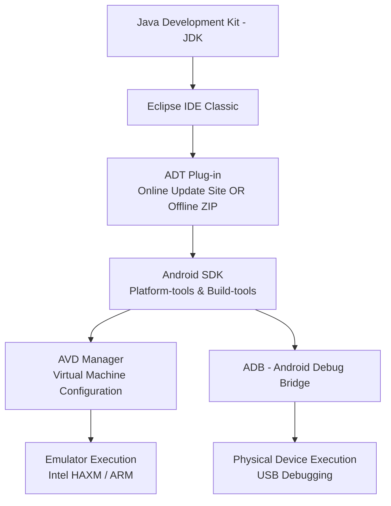

# Unit III: Development Tools — Eclipse, ADT Plug-in & Android Emulator
**Subject:** Android Programming (`BCAFSCO501T23`)  
**Target:** BCA Semester V Mid-Term & University Examination  
**Official Reference:** Professor's Lecture Notes (`BCA-V-Unit-II-III Android Notes.pdf`, Pages 9–13)  

---

## 1. Unconditional Truths (The Axioms)

1. **Decoupled Architecture:** In the classical academic Android toolchain, the Editor/IDE (**Eclipse**), the Bridge/Connector (**ADT Plug-in**), the Platform APIs/Compilers (**Android SDK**), and the Hardware Simulation (**AVD**) are separate decoupled software entities that must be manually integrated.
2. **Runtime Execution Dependency:** Every Android toolchain fundamentally requires a Java Development Kit (**JDK**) with environment variables (`JAVA_HOME`, `PATH`) set at the operating system level, because Android compilers (`javac`, `dx`/`d8`) and IDEs run entirely on top of the Java runtime.
3. **The Emulation Contract:** An **Android Virtual Device (AVD)** is not a generic emulator; it requires a downloaded **System Image** strictly matching the target API level (e.g., API Level 16 for Android 4.1 Jelly Bean) and CPU architecture (x86 or ARM).
4. **Physical Deployment Prerequisite:** Physical USB debugging cannot execute until the Android OS's security sandbox is explicitly unlocked via **Developer Options** (tapping Build Number 7 times) and **USB Debugging** enabled via the Android Debug Bridge (**ADB**).

---

## 2. Motivated Discovery ("Why Does This Exist?")

### Why do university exams emphasize Eclipse and the ADT Plug-in over modern Android Studio?
> While Google officially shifted to Android Studio in late 2014 and deprecated Eclipse ADT in 2015, **Eclipse + ADT remains a mandatory cornerstone of academic curricula** because:
> * Modern Android Studio acts as an all-in-one "black box" where Gradle handles plugins, SDK downloads, and build tasks automatically behind the scenes.
> * Eclipse + ADT forces the engineer to understand **each moving layer of the software development pipeline**:
>   1. The base code editor (Eclipse IDE).
>   2. The plugin bridging the IDE to the build system (ADT).
>   3. The platform toolset that compiles and signs binaries (Android SDK & Build Tools).
>   4. The diagnostics bridge (DDMS & LogCat).
>   5. The hardware emulator (AVD).

Understanding this classical toolchain builds an unbreakable foundation of how operating systems, IDEs, and device bridges interface.

---

## 3. Dependency Map (The Complete Toolchain Pipeline)



---

## 4. Comprehensive Architectural Breakdown & Syllabus Sections

---

### 3.1 Components Required for the Android Environment

| Component | Full Form | Architectural Purpose in Toolchain |
| :--- | :--- | :--- |
| **JDK** | Java SE Development Kit | Compiles `.java` source code into `.class` bytecode; powers Eclipse and Android build utilities. |
| **Eclipse IDE** | Integrated Development Environment | The base workspace editor where Java source, XML layouts, and project assets are authored. |
| **ADT Plug-in** | Android Development Tools | Eclipse extension that adds Android project wizards, XML layout visualizers, DDMS, and build automators. |
| **Android SDK** | Software Development Kit | Houses platform APIs (android.jar), SDK build tools (`aapt`, `dx`), platform tools (`adb`), and system images. |
| **AVD** | Android Virtual Device | QEMU-based virtual machine configured to simulate real device hardware, screen resolutions, and OS versions. |

---

### 3.2 Installing and Using Eclipse with the ADT Plug-in

#### Step 1: Install the JDK & Configure Environment Variables
1. Download and install a compatible Java SE Development Kit (JDK 7 or 8) from Oracle.
2. Set the OS environment variables:
   * **`JAVA_HOME`**: Points to the JDK installation directory (e.g., `C:\Program Files\Java\jdk1.8.0_281`).
   * **`PATH`**: Append `%JAVA_HOME%\bin` (Windows) or `$JAVA_HOME/bin` (Linux/macOS).
3. Verify in command prompt:
   ```bash
   java -version
   javac -version
   ```

#### Step 2: Install Eclipse IDE
1. Download **Eclipse IDE for Java Developers** (Classic package) from `eclipse.org`.
2. Extract the archive (Eclipse requires no OS installer; it is portable).
3. Launch `eclipse.exe` and specify the workspace directory (e.g., `D:\AndroidProjects`).

#### Step 3: Installing the ADT Plug-in (High-Yield 5-Mark Question: Method A vs. Method B)

```
                       Installing the ADT Plug-in into Eclipse
                         ┌─────────────────┴─────────────────┐
                         ▼                                   ▼
             Method A: Online Update Site         Method B: Offline / ZIP Archive
             (Requires live internet access)     (Offline lab / Pre-downloaded file)
```

* **Method A — Via Eclipse Update Site (Online):**
  1. In Eclipse, navigate to **Help $\rightarrow$ Install New Software...**
  2. Click the **Add...** button.
  3. Enter Name: `ADT Plugin` and the Google update site URL in the Location field.
  4. Tick the checkbox for **Developer Tools** (includes Android DDMS, Android Development Tools, Android Hierarchy Viewer, and Traceview).
  5. Click **Next**, accept the license terms, and click **Finish**.
  6. Restart Eclipse when prompted.

* **Method B — Offline / Archive Installation (Preferred in Offline College Labs):**
  1. Pre-download the ADT plug-in `.zip` archive (e.g., `ADT-23.0.6.zip`).
  2. In Eclipse, open **Help $\rightarrow$ Install New Software...**
  3. Click **Add...**, then click the **Archive...** button.
  4. Browse to and select the downloaded local `.zip` archive.
  5. Select **Developer Tools**, accept license terms, click **Finish**, and restart Eclipse.

#### Step 4: Point Eclipse to the Android SDK
1. After restarting Eclipse, go to **Window $\rightarrow$ Preferences $\rightarrow$ Android**.
2. In the **SDK Location** field, browse to the directory where the Android SDK was unpacked (e.g., `C:\android-sdk-windows`).
3. Click **Apply** and **OK**. A green confirmation will verify the path, and the **Android SDK Manager** icon will appear on the toolbar.

---

### 3.3 Installing an Android Virtual Machine (AVD / Emulator)

> **Definition:** An **AVD (Android Virtual Device)** is an emulator configuration that defines the hardware characteristics (RAM, screen size, camera, SD card) and system image (Android version, API level) of the device you wish to simulate.

#### Step-by-Step Procedure to Create an AVD:
1. Open the **SDK Manager** (via toolbar icon or **Window $\rightarrow$ Android SDK Manager**) and ensure that:
   * **SDK Platform-tools** and **SDK Build-tools** are installed.
   * The target **SDK Platform** (e.g., Android 4.1 – Jelly Bean, API Level 16) is installed.
   * The matching **System Image** (e.g., `ARM EABI v7a System Image` or `Intel x86 Atom System Image`) is installed.
2. Open the **AVD Manager**: Go to **Window $\rightarrow$ Android Virtual Device Manager**.
3. Click **Create...** (or **New...**).
4. Fill in the mandatory configuration fields:
   * **AVD Name:** A descriptive tag (e.g., `JellyBean_Test_Device`).
   * **Device:** Hardware profile (e.g., `Nexus S`, `3.2in QVGA (240x320)`).
   * **Target:** Target Android OS version (e.g., `Android 4.1.2 - API Level 16`).
   * **CPU/ABI:** Processor architecture (select `Intel Atom (x86)` for accelerated execution on PCs, or `ARM`).
   * **SD Card:** Specify simulated external storage (e.g., `512 MiB`).
   * **Skin:** Select screen dimensions (e.g., `Skin with dynamic hardware controls`).
   * **Hardware Acceleration:** Enable `Intel HAXM` on Intel machines for 10x faster rendering.
5. Click **OK** to save.
6. Highlight the new device in the list and click **Start... $\rightarrow$ Launch**. Verify that the virtual phone boots to the Android home screen.

---

### 3.4 Configuring the Installed Tools

Before creating a project, verify these **5 critical toolchain checkpoints**:
1. **SDK Location:** Confirm under **Window $\rightarrow$ Preferences $\rightarrow$ Android** that no red error banners exist.
2. **Installed Packages:** Verify target Platform APIs, Platform-tools, and Build-tools are marked *"Installed"* in the SDK Manager.
3. **Environment Variables:** Verify `JAVA_HOME` and `ANDROID_HOME` are set in system variables.
4. **Project Build Target:** Ensure every project's properties target an installed platform version.
5. **OEM USB Drivers:** On Windows, install appropriate manufacturer USB drivers for physical hardware testing.

---

### 3.5 Creating an Android Project in Eclipse

1. In Eclipse, select **File $\rightarrow$ New $\rightarrow$ Project...**
2. Expand the **Android** folder, select **Android Application Project**, and click **Next**.
3. Fill in the Project Specification Form:
   * **Application Name:** The public user-facing app name (e.g., `HelloWorldApp`).
   * **Project Name:** The workspace folder name (auto-filled, e.g., `HelloWorldApp`).
   * **Package Name:** Unique Java namespace following reverse domain notation (e.g., `com.example.helloworldapp`).
   * **Minimum Required SDK:** Lowest Android version the app supports (e.g., `API 14: Android 4.0`).
   * **Target SDK:** The API version the app is optimized for (e.g., `API 16: Android 4.1 Jelly Bean`).
   * **Compile With:** Build platform (choose the installed SDK platform version).
4. Click **Next** through project configuration and launcher icon selection.
5. In the **Create Activity** screen, choose **Blank Activity** and click **Next**.
6. Set the **Activity Name** (e.g., `MainActivity`) and **Layout Name** (e.g., `activity_main`). Click **Finish**.

---

### 3.6 Anatomy of "Hello World" & Running on the Emulator

Eclipse with ADT automatically generates the following 3 foundational files:

#### 1. Layout XML (`res/layout/activity_main.xml`):
```xml
<RelativeLayout xmlns:android="http://schemas.android.com/apk/res/android"
    android:layout_width="match_parent"
    android:layout_height="match_parent">

    <TextView
        android:layout_width="wrap_content"
        android:layout_height="wrap_content"
        android:layout_centerInParent="true"
        android:text="Hello world!"
        android:textSize="22sp" />

</RelativeLayout>
```

#### 2. Java Source Code (`src/com/example/helloworld/MainActivity.java`):
```java
package com.example.helloworld;

import android.app.Activity;
import android.os.Bundle;

public class MainActivity extends Activity {
    @Override
    protected void onCreate(Bundle savedInstanceState) {
        super.onCreate(savedInstanceState);
        // Binds and inflates the XML layout into the Activity window
        setContentView(R.layout.activity_main);
    }
}
```

#### 3. Root Application Manifest (`AndroidManifest.xml`):
```xml
<manifest xmlns:android="http://schemas.android.com/apk/res/android"
    package="com.example.helloworld"
    android:versionCode="1"
    android:versionName="1.0">

    <uses-sdk
        android:minSdkVersion="14"
        android:targetSdkVersion="16" />

    <application
        android:icon="@drawable/ic_launcher"
        android:label="@string/app_name">
        <activity
            android:name=".MainActivity"
            android:label="@string/app_name">
            <intent-filter>
                <action android:name="android.intent.action.MAIN" />
                <category android:name="android.intent.category.LAUNCHER" />
            </intent-filter>
        </activity>
    </application>
</manifest>
```

#### Steps to Run on the Emulator:
1. In the Eclipse Package Explorer, right-click the project root $\rightarrow$ **Run As $\rightarrow$ Android Application**.
2. In the device selection dialog, select your running or configured AVD (e.g., `JellyBean_Test_Device`) and click **OK**.
3. Eclipse automatically:
   * Compiles Java files into `.class` files.
   * Compiles `.class` files into Dalvik Executable (`classes.dex`).
   * Packages resources and `.dex` into an `.apk` file using `aapt`.
   * Transfers and installs the APK onto the emulator via `adb`.
   * Sends an intent to launch `MainActivity`.
4. The emulator screen displays *"Hello world!"* centered on the screen.
5. Use **LogCat** (**Window $\rightarrow$ Show View $\rightarrow$ Android $\rightarrow$ LogCat**) to monitor real-time system logs and exceptions.

---

### 3.7 Deploying on a Physical USB-Connected Device

#### Step-by-Step Hardware Preparation:
1. **Unlock Developer Mode:** On the smartphone, navigate to **Settings $\rightarrow$ About Phone**, locate **Build Number**, and tap it **7 consecutive times** until the toast notification announces: *"You are now a developer!"*.
2. **Enable USB Debugging:** Return to **Settings $\rightarrow$ Developer Options** and enable **USB Debugging**.
3. **Connect Cable:** Connect the smartphone to the PC via a USB data cable.
4. **Install Windows OEM Drivers:** Ensure appropriate device drivers (Samsung, Google, Xiaomi) are installed.
5. **Verify Device Connection via Terminal:** Open command prompt and run:
   ```bash
   adb devices
   ```
   *Expected Output:*
   ```text
   List of devices attached
   42004c219a1284b1    device
   ```
6. **Deploy via Eclipse:** Right-click the project $\rightarrow$ **Run As $\rightarrow$ Android Application**.
7. In the Android Device Chooser, select the **Physical Device** (shows serial number/model) and click **OK**. The APK installs and boots directly on the real phone screen.

---

### 3.8 Emulator (AVD) vs. Physical USB Device (Guaranteed 5-Mark Comparison Table)

| Comparison Aspect | Android Virtual Device (AVD Emulator) | USB-Connected Physical Device |
| :--- | :--- | :--- |
| **Setup Effort** | High initial download size (1–3 GB per system image); slower first boot. | Zero emulator download; requires enabling Developer Options + USB drivers. |
| **Performance** | Slower (especially ARM emulation without HAXM hardware acceleration). | Full native bare-metal hardware execution speed. |
| **Hardware Sensors** | Simulated (accelerometer, GPS, camera, gyroscope are mocked or unavailable). | Full real-world access to true sensors, camera, Bluetooth, and cellular network. |
| **Cost** | 100% Free; can emulate hundreds of screen sizes and resolutions. | Requires purchasing physical smartphone hardware. |
| **Battery & Thermals** | Powered by development PC. | Discharges/charges phone battery during long testing sessions. |
| **Primary Use Case** | Initial development, layout testing across diverse screen sizes & API versions. | Final performance profiling, real touch latency testing, and battery drain analysis. |

---

## 5. Key Takeaways & Exam Scoring Pitfalls

* ⚠️ **Pitfall 1: Confusing ADT with SDK.** Remember: **ADT** is an Eclipse *plug-in* that lives inside the IDE. The **SDK** is an external *directory of compilers, libraries, and images*. Eclipse uses ADT to talk to the SDK!
* ⚠️ **Pitfall 2: Forgetting `setContentView(R.layout.activity_main)`.** In a 10-mark question asking for "Hello World code", forgetting `setContentView()` means the Java code will not bind to the XML, resulting in a blank screen.
* ⚠️ **Pitfall 3: Not mentioning both ADT installation methods.** If asked how to install ADT, examiners specifically award marks for describing **both Method A (Online URL)** and **Method B (Offline ZIP Archive)**.
* ⚠️ **Pitfall 4: Missing the 7-tap procedure.** For USB deployment, explicitly mention: *"Tap Build Number 7 times in Settings $\rightarrow$ About Phone to reveal Developer Options."*

---

## 6. Official Professor Practice Questions with Model Answers

### Q1 (5 Marks): List the components required to set up a complete Android development environment using Eclipse, and explain the role of each.
> **Model Answer:** A complete classical Android development setup requires:
> 1. **JDK (Java Development Kit):** Provides the Java compiler (`javac`) and runtime needed by Eclipse and the Android compilation pipeline.
> 2. **Eclipse IDE:** The graphical workbench where code is written and files are managed.
> 3. **ADT (Android Development Tools) Plug-in:** An Eclipse extension that provides Android project wizards, XML editors, graphical layout builders, and links Eclipse to the SDK.
> 4. **Android SDK:** Contains Android API libraries (`android.jar`), build tools (`aapt`, `dx`), and platform tools (`adb`).
> 5. **AVD (Android Virtual Device):** Emulates an Android mobile device on the PC to test applications without physical hardware.

---

### Q2 (5 Marks): Explain the two methods of installing the ADT plug-in into Eclipse.
> **Model Answer:**
> * **Method A (Online Update Site):** Go to **Help $\rightarrow$ Install New Software... $\rightarrow$ Add...**, enter a name and the official Google update site URL, select **Developer Tools**, accept license terms, and restart Eclipse.
> * **Method B (Offline / ZIP Archive):** Download the standalone `ADT-xx.zip` file. In Eclipse, select **Help $\rightarrow$ Install New Software... $\rightarrow$ Add... $\rightarrow$ Archive...**, browse to the local `.zip` file, select **Developer Tools**, finish installation, and restart Eclipse. Ideal for offline college lab machines.

---

### Q3 (10 Marks): What is an AVD? Describe the step-by-step procedure to create an AVD for testing an Android 4.1 (Jelly Bean) application.
> **Model Answer:**
> An AVD (Android Virtual Device) is an emulator configuration defining the hardware specs and Android software image for a simulated device.
> **Creation Steps:**
> 1. Open the Android SDK Manager and ensure the **Android 4.1 (API 16) SDK Platform** and **System Image (ARM or Intel x86)** are installed.
> 2. Open **Window $\rightarrow$ Android Virtual Device Manager**.
> 3. Click **Create...** or **New...**.
> 4. Configure parameters:
>    * *AVD Name:* `JellyBean_Emulator`
>    * *Device Profile:* Nexus S (480 x 800)
>    * *Target:* Android 4.1.2 - API Level 16
>    * *CPU/ABI:* Intel Atom (x86) or ARM (armeabi-v7a)
>    * *Memory:* 512 MB RAM, 64 MB VM Heap
>    * *SD Card:* 512 MB
> 5. Click **OK**, select the created AVD, and click **Start... $\rightarrow$ Launch**.

---

### Q4 (10 Marks): Outline the complete steps to create and run a "Hello World" Android project in Eclipse with ADT. Write the XML layout and Java Activity code.
> **Model Answer:**
> **Steps:**
> 1. Select **File $\rightarrow$ New $\rightarrow$ Project... $\rightarrow$ Android $\rightarrow$ Android Application Project**.
> 2. Enter Application Name (`HelloWorld`), Project Name (`HelloWorld`), and Package Name (`com.example.helloworld`).
> 3. Set Minimum SDK to API 14 and Target SDK to API 16.
> 4. Select **Blank Activity**, set Activity name to `MainActivity` and Layout name to `activity_main`. Click **Finish**.
> 5. **XML Layout (`res/layout/activity_main.xml`):**
>    ```xml
>    <RelativeLayout xmlns:android="http://schemas.android.com/apk/res/android"
>        android:layout_width="match_parent"
>        android:layout_height="match_parent">
>        <TextView
>            android:layout_width="wrap_content"
>            android:layout_height="wrap_content"
>            android:layout_centerInParent="true"
>            android:text="Hello world!"
>            android:textSize="20sp" />
>    </RelativeLayout>
>    ```
> 6. **Java Activity (`MainActivity.java`):**
>    ```java
>    package com.example.helloworld;
>    import android.app.Activity;
>    import android.os.Bundle;
>    public class MainActivity extends Activity {
>        @Override
>        protected void onCreate(Bundle savedInstanceState) {
>            super.onCreate(savedInstanceState);
>            setContentView(R.layout.activity_main);
>        }
>    }
>    ```
> 7. Right-click project $\rightarrow$ **Run As $\rightarrow$ Android Application** $\rightarrow$ select running AVD.

---

### Q5 (5 Marks): What settings must be configured on a physical Android smartphone before it can be used for USB app deployment?
> **Model Answer:**
> 1. **Enable Developer Options:** Go to **Settings $\rightarrow$ About Phone** and tap **Build Number** 7 times continuously until the developer prompt appears.
> 2. **Enable USB Debugging:** Open **Settings $\rightarrow$ Developer Options** and switch **USB Debugging** to ON.
> 3. **Authorize Host Machine:** Connect the phone via USB cable and tap **Allow USB Debugging** on the smartphone screen.
> 4. **Install OEM USB Drivers:** Ensure device drivers are installed on the development PC so that `adb devices` recognizes the device.

---

### Q6 (5 Marks): Compare testing an application on an Emulator versus a Physical USB-Connected Device across at least 4 parameters.
> *(Provide the 6-parameter table from Section 3.8 comparing Setup Effort, Performance, Hardware Sensors, Cost, Battery/Thermals, and Primary Use Case).*
